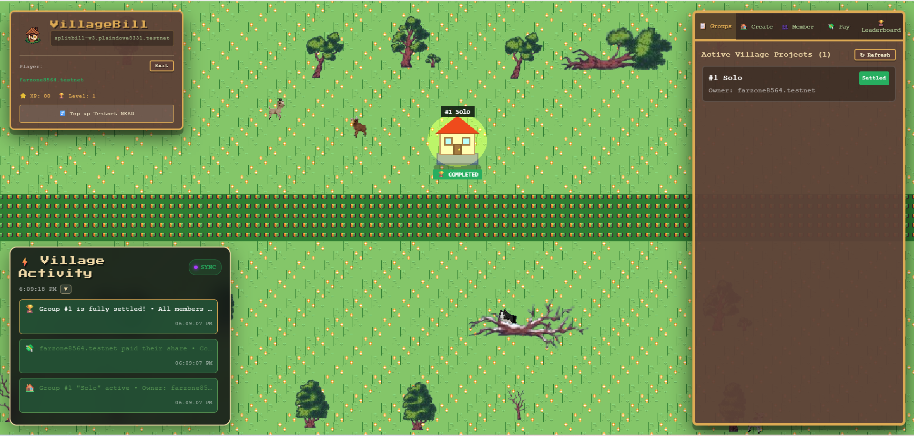
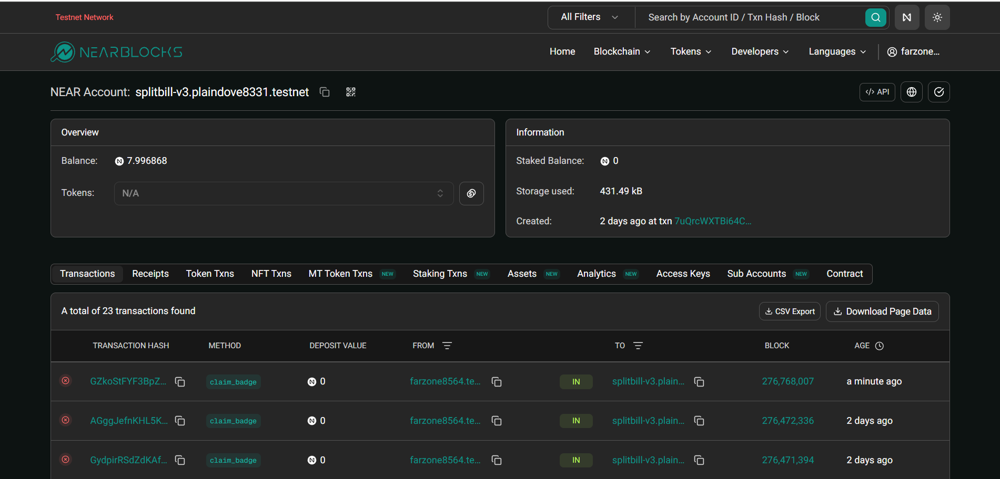
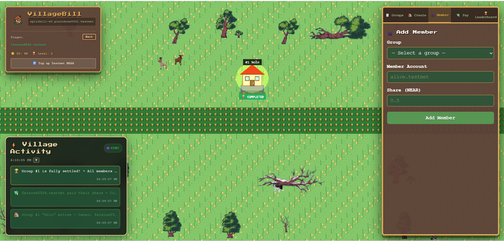
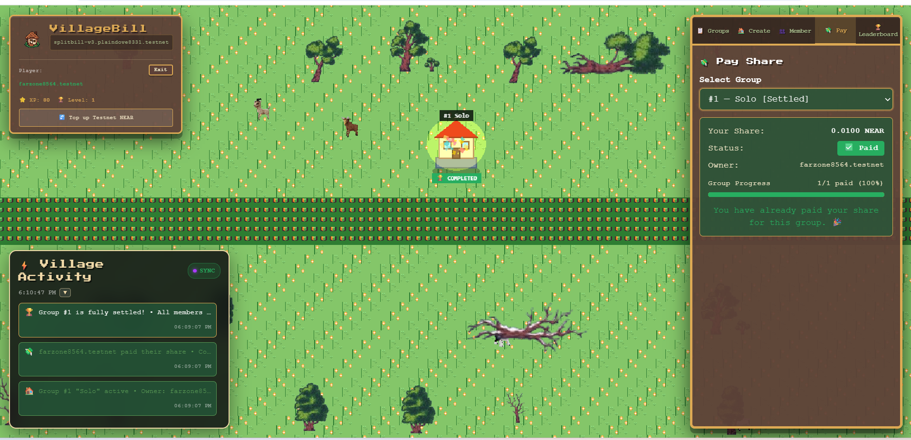
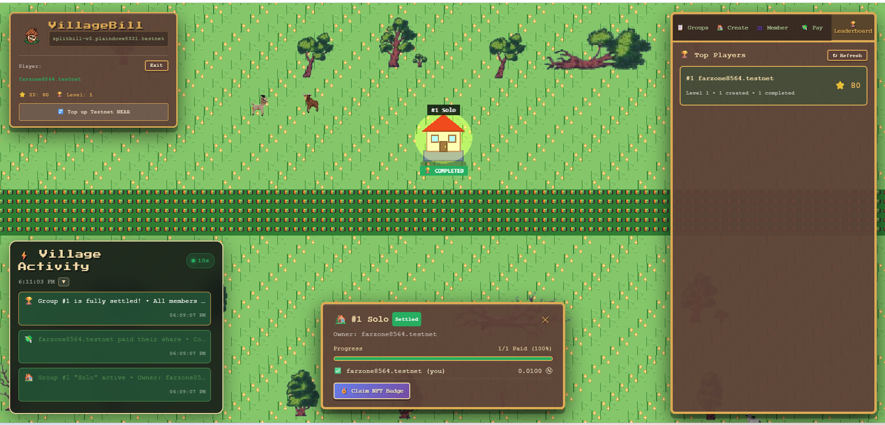

# 🏡 VillageBill — Split Bills, Build Villages

**VillageBill** is a group expense tracker (split bill) built on the **NEAR blockchain**, wrapped in a 2D pixel-art village game. One group equals one building. As members pay their share *on-chain*, the building visually upgrades from an empty plot to a glowing house. Once fully paid, members can claim an NFT badge and earn XP to climb the leaderboard.

🌐 **Live Demo:** [https://villagebill.vercel.app](https://villagebill.vercel.app)  
🎥 **Video Demo:** [Watch on X (Twitter)](https://x.com/anay29758/status/2119386319357173885)

---

## 🔗 Relation to Pre-existing Work (Hackathon Disclosure)

This project is a port and massive extension of an existing Stellar Soroban project named [SplitBill](https://github.com/yyred-max/Stellar-meetup).
- **Baseline (Pre-Hackathon):** The original Stellar Rust contracts and basic React frontend.
- **Hackathon Contribution (Nov 1 - Nov 14):** 
  - Completely ported the smart contract from Stellar to **NEAR Protocol** using `near-sdk-rs`.
  - Added **NEP-171 NFT badges** and an **XP/Leaderboard** system.
  - Integrated **Phaser 3** to create a full-screen 2D pixel-art village game.
  - Implemented real-time "Puzzle Building" visual logic based on on-chain payment progress.
  - Added NEAR Wallet Selector (Meteor Wallet) and a responsive floating HUD.

---

## 🖼️ Screenshots

| Game Map & HUD | On-Chain Proof (NearBlocks) |
| :---: | :---: |
|  |  |

| Create Group | Add Member |
| :---: | :---: |
|  |  |

| Pay Share | Leaderboard & Claim NFT |
| :---: | :---: |
|  |  |

---

## 🚀 How to Try (Do X - See Y)

Judges can easily test the app using the NEAR Testnet:

1. Go to **[https://villagebill.vercel.app](https://villagebill.vercel.app)**.
2. Connect your **NEAR testnet wallet** (Meteor Wallet). *Tip: Use the "🚰 Top up Testnet NEAR" button in the top-left if you need testnet tokens.*
3. Click the **"🏠 Create"** tab on the right sidebar and create a group named "Dinner".
4. Click the **"👥 Member"** tab, add yourself with a share (e.g., `0.1` NEAR).
5. Click the **"💸 Pay"** tab, select the group, and pay the share.
6. **See the magic:** Look at the village map. Your empty plot will transform into a foundation, then walls, and finally a completed glowing house!
7. Click the group details and click **"🎖️ Claim NFT Badge"**.
8. Check the **"🏆 Leaderboard"** tab to see your XP and Level!

*(Alternatively, you can watch the [Video Demo on X](https://x.com/anay29758/status/2119386319357173885) first).*

---

## ✨ Key Features

- **NEAR Smart Contract (Rust):** Secure, on-chain logic for group creation, member management, and payments.
- **Phaser 3 Game World:** A fully interactive 2D pixel-art map where buildings evolve in real-time based on the percentage of funds collected.
- **NFT Badges (NEP-171):** Members who fully pay their share receive an on-chain NFT badge as proof of contribution.
- **XP & Leaderboard:** Players earn XP for creating groups (+10), paying shares (+20), and settling groups (+50). Level = `XP / 100 + 1`.
- **Multi-Wallet Support:** Powered by `@near-wallet-selector` (Meteor Wallet).
- **Responsive HUD:** A modern UI overlay that works seamlessly on desktop and mobile.

---

## 🧱 Tech Stack

| Component | Technology |
| :--- | :--- |
| **Smart Contract** | Rust + `near-sdk-rs` + `near-contract-standards` (NEP-171) |
| **Frontend** | React + TypeScript + Vite |
| **Game Engine** | Phaser 3 |
| **Wallet Integration**| `@near-wallet-selector` (Meteor Wallet) |
| **Network** | NEAR Testnet |

---

## 📜 Deployed Contract (Testnet)

- **Contract Address:** `splitbill-v3.plaindove8331.testnet`
- **Explorer:** [View on NearBlocks](https://testnet.nearblocks.io/address/splitbill-v3.plaindove8331.testnet)

---

## 🤖 AI & Library Disclosure

- **AI Coding Assistants:** Claude 3.5 Sonnet, Gemini 2.5 Flash, and Hermes were used for code generation, architectural planning, and debugging.
- **Audio Generation:** ElevenLabs API was used to generate the voiceover narration for the demo video.
- **Assets:** 2D pixel art assets are based on the CC0 Kenney Tiny Town pack, with custom procedural Phaser Graphics for the buildings and animals.

---

## 📄 License

MIT — free to use and modify.

---
Built with ❤️ for the **NEAR Hackathon**.